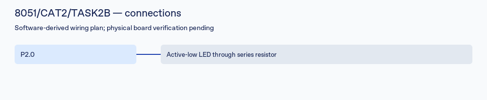

# 8051/CAT2/TASK2B: Software-delay LED blink

Student: **LAKSHMI KARTHIK VEMULA** · Registration: **25011102113**
Course: Fundamentals of IoT Laboratory · Shiv Nadar University Chennai, Computer Science and Engineering

## Aim

Implement and examine software-delay led blink on AT89S52, classic 12-clock 8051, 11.0592 MHz.

## Components required and hardware platform

AT89S52 board, 11.0592 MHz crystal, regulated 5 V supply, programmer, and the peripherals listed below.

VCC pin 40 to regulated 5 V; GND pin 20; EA pin 31 HIGH for internal Flash. Use the board crystal and an active-HIGH reset pulse with RST normally LOW. A bare-chip reset uses a resistor from RST to GND and a capacitor from VCC to RST. Verify against the board schematic.

## Circuit diagram



This schematic records the configured software pins. Actual board wiring, component ratings and timing have **NOT VERIFIED** status.

## Pin connections

| MCU signal | Connection |
|---|---|
| P2.0 | Active-low LED through series resistor |

Use individual current-limiting resistors for LEDs and seven-segment segments. Port 0 on the 8051 needs external pull-ups; use a suitable display driver rather than exceeding GPIO current ratings. Never drive motor coils directly from an MCU; use a ULN2003 and the motor-rated supply with common ground.

## Working principle and implementation

The LED alternates on and off. Software-loop timing is uncalibrated.

Read the complete [application source](main.c) for the implemented state transitions, parser, delays and peripheral initialization. Documentation follows the actual code, rather than conflicting titles in the source reference.

## Compilation instructions

From the repository root, run:

```sh
python3 tools/build.py 8051/CAT2/TASK2B
```

See [toolchain setup and build limits](../../../docs/BUILDING.md). Fresh firmware is written to `Objects/firmware.hex`. SDCC builds a mechanically syntax-translated copy; its own startup is used. The included Keil C51 startup and project have not been executed in Keil.

## Expected output

The LED alternates on and off. Software-loop timing is uncalibrated.

## Actual verified results

See [recorded build and file checks](../../../docs/VALIDATION.md) for the result and artifact hash. A successful compile/link does not verify timing, peripherals or assignment behavior. Hardware execution, oscilloscope measurements and simulator runs are **NOT VERIFIED**.

## References and attribution

This task contains reference-derived source/project material, with documented corrections. It is not represented as solely student-authored code or as independently completed physical laboratory work. See [provenance and third-party notices](../../../docs/ATTRIBUTION.md). The circuit SVG and this task documentation were generated for this repository.
