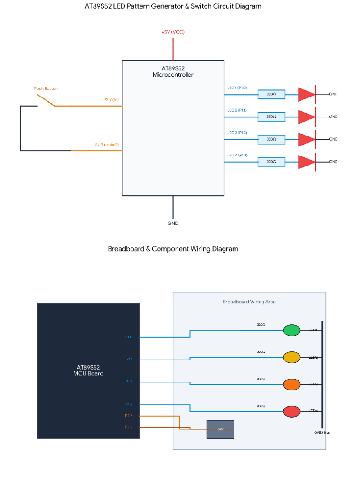

# CAT 03 — 8051 LED Pattern Generator with Push Button

[Source Code](Source_Code/led_pattern.c)

## Aim

Write an Embedded C program for the AT89S52 microcontroller to generate multiple LED display patterns on four LEDs connected to P1.0–P1.3. A push button on P2.7 cycles through five modes (off, chase, binary count, alternate, all-blink) with software debouncing.

## Components Required

| Component | Specification |
| --- | --- |
| Microcontroller | AT89S52 (8051 family), 40-pin DIP |
| Crystal Oscillator | 12 MHz |
| Capacitors | 2 × 33 pF (crystal), 1 × 10 µF (reset) |
| Resistors | 4 × 330 Ω (LED current-limiting), 10 kΩ (RST pull-up) |
| LEDs | 4 × red/green/orange/yellow, through-hole |
| Push button | Normally-open, momentary |
| Power supply | 5 V DC regulated |
| Development tools | Keil µVision (C51 compiler), ISP programmer |

## Circuit Diagram

The AT89S52 is powered at VCC (pin 40, +5 V) with GND at pin 20. Four LEDs are connected from P1.0–P1.3 through 330 Ω resistors to GND. The push button connects P2.7 to GND (active-LOW); no external pull-up is needed because the 8051 port pins have internal pull-ups. P2.3 is used as an output indicator. The 12 MHz crystal and reset circuit are standard.

## Pin Connections

| Signal | AT89S52 Pin | External Connection |
| --- | --- | --- |
| VCC | 40 | +5 V supply |
| GND | 20 | Ground rail |
| XTAL2 / XTAL1 | 18 / 19 | 12 MHz crystal |
| RST | 9 | 10 kΩ to VCC; 10 µF to GND |
| P1.0 (LED 1) | 1 | 330 Ω → LED1 anode → cathode → GND |
| P1.1 (LED 2) | 2 | 330 Ω → LED2 anode → cathode → GND |
| P1.2 (LED 3) | 3 | 330 Ω → LED3 anode → cathode → GND |
| P1.3 (LED 4) | 4 | 330 Ω → LED4 anode → cathode → GND |
| P2.7 (button in) | 28 | Push button → GND (active-LOW) |
| P2.3 (output) | 24 | Optional indicator / buzzer |

## Working Principle

The program maintains a global `mode` variable (0–4). The `check()` function polls P2.7; when a LOW level is detected it applies a software debounce delay, confirms the press, increments `mode` modulo 5, waits for button release, and applies another debounce delay. The `run()` function dispatches to the appropriate pattern function based on the current mode.

| Mode | LED Pattern |
| --- | --- |
| 0 | All LEDs OFF |
| 1 | Chase (LED1 → LED2 → LED3 → LED4 → repeat) |
| 2 | 4-bit binary counter 0–15 on LED1–LED4 |
| 3 | Alternate pairs (LED1+LED3 ↔ LED2+LED4) |
| 4 | All LEDs blink simultaneously |

## Procedure

1. Connect four LEDs to P1.0–P1.3 each through a 330 Ω resistor.
2. Connect a push button between P2.7 and GND.
3. Create a Keil C51 project, add `led_pattern.c`, and set CPU frequency to 12 MHz.
4. Build and flash the HEX file.
5. Power on; LEDs are initially off (Mode 0). Press the button to cycle through each pattern.

## Source Code

[led_pattern.c](Source_Code/led_pattern.c)

The program uses four `sbit` declarations for the LEDs and two for the button (`in = P2^7`) and output (`out = P2^3`). Five pattern functions (`mode1`–`mode4`) and an idle state (`mode == 0`) are dispatched from `run()`. Debouncing is achieved with a double-sample in `check()` separated by a software delay.

## Expected Output

| Button Press | Active Pattern |
| --- | --- |
| 0 (power-on) | All LEDs off |
| 1st press | Chase sequence: one LED lit at a time |
| 2nd press | Binary count 0 → 15 on 4 LEDs |
| 3rd press | Alternate pairs blinking |
| 4th press | All four LEDs blink together |
| 5th press | Returns to all-off (Mode 0) |

## Actual Output

Physical hardware execution is pending. Code review confirms correct debounce logic and pattern sequencing.

## Result

The program demonstrates GPIO output pattern generation and button-controlled state machine operation on the 8051. Each press reliably cycles to the next mode due to the double-sample debounce in `check()`.
