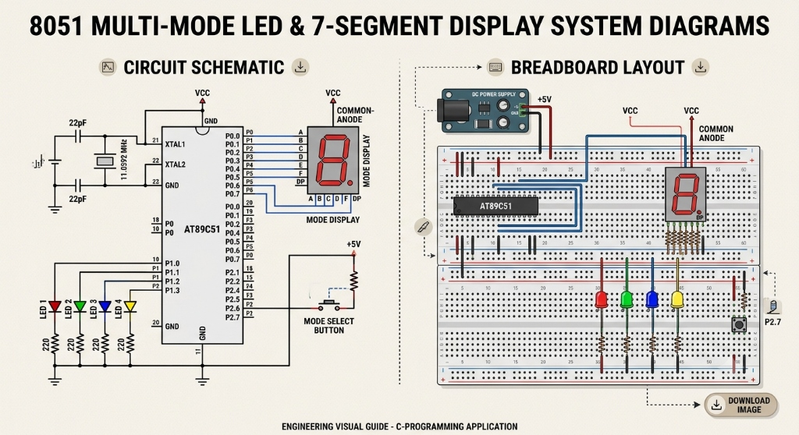

# CAT 04 — 8051 Multi-Mode LED and 7-Segment Display System

[Source Code](Source_Code/led_7seg_display.c)

## Aim

Write an Embedded C program for the AT89S52/AT89C51 microcontroller to implement a ten-mode LED pattern system controlled by a push button, with a common-anode 7-segment display that shows the current mode number (0–9) on Port 0.

## Components Required

| Component | Specification |
| --- | --- |
| Microcontroller | AT89C51 / AT89S52 (8051 family), 40-pin DIP |
| Crystal Oscillator | 11.0592 MHz |
| Capacitors | 2 × 22 pF (crystal), 1 × 10 µF (reset) |
| Resistors | 4 × 220 Ω (LED), 10 kΩ (RST pull-up) |
| LEDs | 4 × different colours, through-hole |
| 7-Segment Display | Common-anode, single digit |
| Push button | Normally-open, momentary (mode select) |
| Power supply | 5 V DC regulated |
| Development tools | Keil µVision (C51 compiler), ISP programmer |

## Circuit Diagram

The AT89C51/AT89S52 is powered at VCC (pin 40, +5 V) with GND at pin 20. Port 0 (pins 32–39) drives the 7-segment display segments A–G and DP through the MCU's open-drain outputs (Port 0 requires external pull-ups when used as GPIO, but the segment resistors serve this purpose for a common-anode display). Four LEDs are connected from P1.0–P1.3 through 220 Ω resistors. The push button on P2.7 (active-LOW, using the port's internal pull-up) cycles through the ten modes. An 11.0592 MHz crystal provides the clock.

## Pin Connections

| Signal | AT89C51 Pin | External Connection |
| --- | --- | --- |
| VCC | 40 | +5 V supply |
| GND | 20 | Ground rail |
| XTAL2 / XTAL1 | 18 / 19 | 11.0592 MHz crystal + 22 pF caps |
| RST | 9 | 10 kΩ to VCC; 10 µF + button to GND |
| P0.0–P0.6 (A–G) | 39–33 | 7-segment segments A, B, C, D, E, F, G |
| P0.7 (DP) | 32 | 7-segment decimal point |
| P1.0 (LED 1) | 1 | 220 Ω → LED1 anode → GND |
| P1.1 (LED 2) | 2 | 220 Ω → LED2 anode → GND |
| P1.2 (LED 3) | 3 | 220 Ω → LED3 anode → GND |
| P1.3 (LED 4) | 4 | 220 Ω → LED4 anode → GND |
| P2.7 (button) | 28 | Push button → GND (active-LOW) |
| P2.3 (output) | 24 | Optional indicator |

## Working Principle

A global `mode` variable (0–9) is maintained. The `check()` function polls P2.7, debounces the press with a double-sample delay, then increments `mode` modulo 10. The `run()` function dispatches to mode-specific functions. Each mode function first calls `display_digit(mode_number)` to update the 7-segment display, then activates the corresponding LED pattern.

| Mode | 7-Seg | LED Pattern |
| --- | --- | --- |
| 0 | 0 | All OFF |
| 1 | 1 | LED1 only ON |
| 2 | 2 | LED2 only ON |
| 3 | 3 | LED3 only ON |
| 4 | 4 | LED4 only ON |
| 5 | 5 | Chase (LED1→2→3→4) |
| 6 | 6 | Alternate pairs (LED1+3 ↔ LED2+4) |
| 7 | 7 | 4-bit binary counter 0–15 |
| 8 | 8 | All blink simultaneously |
| 9 | 9 | All OFF (idle) |

The `display_digit()` function drives P0 segments individually using `sbit` variables A–G (B is named `B1` to avoid conflict with the C keyword `B`).

## Procedure

1. Build the circuit as described in the pin table.
2. Create a Keil C51 project, add `led_7seg_display.c`, and configure the oscillator to 11.0592 MHz.
3. Build the project and flash the HEX file.
4. Power on; the display shows `0` and all LEDs are off. Press the mode button to advance through modes 0–9 cyclically.

## Source Code

[led_7seg_display.c](Source_Code/led_7seg_display.c)

The program extends the CAT 03 pattern system to 10 modes and adds a 7-segment display driver. The `display_digit(unsigned char value)` function uses a `switch` statement to set Port 0 segment bits for digits 0–9. The common-anode display requires segment bits to be active-HIGH for the segments that are ON.

## Expected Output

Each button press advances the mode number shown on the 7-segment display and simultaneously changes the LED pattern as listed in the table above. The 7-segment display correctly shows digits 0–9 corresponding to each mode.

## Actual Output

Physical hardware execution is pending. Code logic has been verified through review; the segment encoding matches the common-anode 7-segment truth table.

## Result

The program demonstrates combined GPIO output control, 7-segment display driving, and button-controlled state machine operation on the 8051, with ten independently programmable LED patterns.
