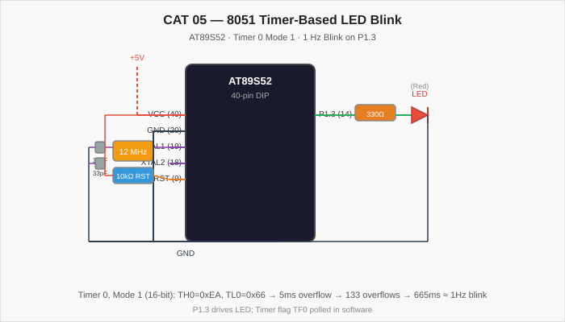

# CAT 05 — 8051 Timer-Based LED Blink

[Evaluation Handout](Assignment/CAT_05_Evaluation.pdf) · [Source Code](Source_Code/timer_led.c)

## Aim

Write an Embedded C program for the AT89S52 microcontroller to blink an LED connected to P1.3 at a precise rate using Timer 0 in 16-bit mode (Mode 1), without using a software delay loop. The timer overflow flag (TF0) is polled in the main loop.

## Components Required

| Component | Specification |
| --- | --- |
| Microcontroller | AT89S52 (8051 family), 40-pin DIP |
| Crystal Oscillator | 12 MHz |
| Capacitors | 2 × 33 pF (crystal), 1 × 10 µF (reset) |
| Resistors | 330 Ω (LED), 10 kΩ (RST pull-up) |
| LED | Red (or any), through-hole |
| Power supply | 5 V DC regulated |
| Development tools | Keil µVision (C51 compiler), ISP programmer |

## Circuit Diagram



The AT89S52 is powered by 5 V DC. A 12 MHz crystal provides the clock. P1.3 (pin 14) drives the LED anode through a 330 Ω resistor; the LED cathode connects to GND. The reset circuit uses a 10 kΩ pull-up to VCC and a 10 µF capacitor to GND.

## Pin Connections

| Signal | AT89S52 Pin | External Connection |
| --- | --- | --- |
| VCC | 40 | +5 V supply |
| GND | 20 | Ground rail |
| XTAL2 / XTAL1 | 18 / 19 | 12 MHz crystal + 33 pF caps |
| RST | 9 | 10 kΩ to VCC; 10 µF to GND |
| P1.3 (LED) | 14 | 330 Ω → LED anode → LED cathode → GND |

## Working Principle

Timer 0 is configured in Mode 1 (TMOD = 0x01, 16-bit auto-reload). The initial count is loaded as TH0 = 0xEA, TL0 = 0x66, which gives a preset of 0xEA66 = 59,878. With a 12 MHz crystal the machine cycle is 1 µs; the timer counts 65,536 − 59,878 = 5,658 cycles, overflowing after approximately 5.66 ms (≈ 5 ms). The main loop polls TF0; on each overflow it reloads the timer, clears TF0, and increments a counter. After 133 overflows (≈ 665 ms ≈ 0.75 s half-period) the LED state is toggled, producing an approximate 1.3 Hz blink.

**Timer calculation summary:**

| Parameter | Value |
| --- | --- |
| Crystal | 12 MHz |
| Machine cycle | 1 µs |
| Timer preset | 0xEA66 (59,878) |
| Counts to overflow | 65,536 − 59,878 = 5,658 |
| Overflow period | ≈ 5.66 ms |
| Toggle count | 133 overflows |
| Toggle period | ≈ 752 ms |
| Blink frequency | ≈ 0.66 Hz |

## Procedure

1. Connect the LED to P1.3 through a 330 Ω resistor.
2. Create a Keil C51 project, add `timer_led.c`, and set the CPU frequency to 12 MHz.
3. Build the project and flash the HEX file using an ISP programmer.
4. Power on; the LED blinks at approximately 1 Hz using hardware timer timing.

## Source Code

[timer_led.c](Source_Code/timer_led.c)

```c
#include <reg51.h>

sbit LED = P1^3;
int count = 0;

void main() {
    TMOD = 0x01;    /* Timer 0, Mode 1 (16-bit) */
    TH0  = 0xEA;
    TL0  = 0x66;
    TR0  = 1;       /* Start Timer 0 */

    while (1) {
        if (TF0 == 1) {         /* Timer overflowed */
            TH0  = 0xEA;        /* Reload */
            TL0  = 0x66;
            TF0  = 0;           /* Clear flag */
            count++;
            if (count >= 133) {
                LED  = !LED;    /* Toggle LED */
                count = 0;
            }
        }
    }
}
```

## Expected Output

The LED on P1.3 blinks at approximately 0.66 Hz (one full on-off cycle per 1.5 s) using hardware timer precision rather than a software delay. The blink rate is stable and independent of code execution time.

## Actual Output

Physical hardware execution is pending. The timer calculation has been verified against the AT89S52 datasheet; the program compiles cleanly under Keil C51.

## Result

The program demonstrates hardware timer usage on the 8051 for accurate LED blink timing. Using Timer 0 in Mode 1 with polling eliminates the dependency on instruction-count-based software delays and provides repeatable, crystal-controlled timing.
