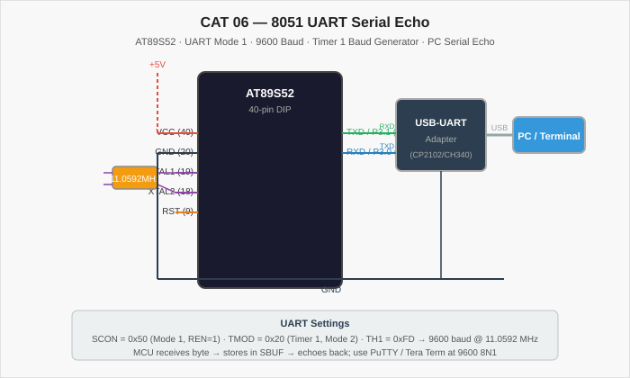

# CAT 06 — 8051 UART Serial Echo

[Evaluation Handout](Assignment/CAT_06_Evaluation.pdf) · [Source Code](Source_Code/uart_echo.c)

## Aim

Write an Embedded C program for the AT89S52 microcontroller to implement a UART serial echo: the MCU waits for a character received over the serial port, stores it in SBUF, and immediately retransmits the same character back to the PC terminal.

## Components Required

| Component | Specification |
| --- | --- |
| Microcontroller | AT89S52 (8051 family), 40-pin DIP |
| Crystal Oscillator | 11.0592 MHz (required for exact baud rates) |
| Capacitors | 2 × 22 pF (crystal), 1 × 10 µF (reset) |
| Resistors | 10 kΩ (RST pull-up) |
| USB-to-UART Adapter | CP2102, CH340, or FT232 (3.3 V / 5 V logic level) |
| PC / Laptop | With PuTTY or Tera Term installed |
| Power supply | 5 V DC regulated |
| Development tools | Keil µVision (C51 compiler), ISP programmer |

## Circuit Diagram



The AT89S52 is clocked by an 11.0592 MHz crystal (chosen to give zero baud-rate error at 9600 baud). The USB-to-UART adapter connects: its RXD pin to the MCU's TXD (P3.1, pin 11), its TXD pin to the MCU's RXD (P3.0, pin 10), and its GND to the common ground rail. No RS-232 level converter is needed if the adapter uses 5 V TTL logic.

## Pin Connections

| Signal | AT89S52 Pin | External Connection |
| --- | --- | --- |
| VCC | 40 | +5 V supply |
| GND | 20 | Common ground |
| XTAL2 / XTAL1 | 18 / 19 | 11.0592 MHz crystal + 22 pF caps |
| RST | 9 | 10 kΩ to VCC; 10 µF to GND |
| TXD / P3.1 | 11 | → RXD of USB-UART adapter |
| RXD / P3.0 | 10 | → TXD of USB-UART adapter |
| GND (adapter) | — | Common GND |

## Working Principle

The 8051 UART is configured in Mode 1 (8-bit variable baud rate). Timer 1 operates in Mode 2 (8-bit auto-reload) as the baud rate generator. With TH1 = 0xFD and an 11.0592 MHz crystal, the baud rate is 9600 bps (0% error). `SCON = 0x50` sets Mode 1 and enables the receiver (REN = 1). The main loop:
1. Waits for RI (Receive Interrupt flag) to become 1.
2. Reads the received character from SBUF into `ch`.
3. Clears RI.
4. Writes `ch` back to SBUF (transmit).
5. Waits for TI (Transmit Interrupt flag) to become 1.
6. Clears TI.

**UART configuration:**

| Register | Value | Meaning |
| --- | --- | --- |
| SCON | 0x50 | Mode 1 (8-bit), REN = 1 |
| TMOD | 0x20 | Timer 1, Mode 2 (auto-reload) |
| TH1 | 0xFD | 9600 baud @ 11.0592 MHz |
| TR1 | 1 | Start Timer 1 |

## Procedure

1. Connect the USB-UART adapter to the MCU (TXD→RXD, RXD→TXD, GND→GND).
2. Add the adapter to the PC and identify its COM port in Device Manager.
3. Create a Keil C51 project, add `uart_echo.c`, and configure the CPU to 11.0592 MHz.
4. Build and flash the HEX file.
5. Open PuTTY or Tera Term: set the port, 9600 baud, 8N1, no flow control.
6. Type any character — it should appear in the terminal as the MCU echoes it back.

## Source Code

[uart_echo.c](Source_Code/uart_echo.c)

```c
#include <reg52.h>

void main(void) {
    char ch;

    SCON = 0x50;    /* UART Mode 1, receiver enabled */
    TMOD = 0x20;    /* Timer 1, Mode 2 (auto-reload)  */
    TH1  = 0xFD;    /* 9600 baud @ 11.0592 MHz        */
    TR1  = 1;       /* Start Timer 1                  */

    while (1) {
        while (RI == 0);   /* Wait for byte received   */
        ch = SBUF;         /* Read received character  */
        RI = 0;            /* Clear receive flag       */

        SBUF = ch;         /* Echo the character back  */
        while (TI == 0);   /* Wait for transmit done   */
        TI = 0;            /* Clear transmit flag      */
    }
}
```

> **Note** — The source file uses `reg52.h` (AT89S52 / 8052 peripheral register definitions). The only change from `reg51.h` is extended Timer 2 support; UART and Timer 1 registers are identical.

## Expected Output

Every character typed in the PC terminal is echoed back immediately, appearing twice if the terminal is set to full-duplex echo, or once if set to half-duplex (echo from MCU only).

## Actual Output

Physical hardware execution and terminal capture are pending. The UART configuration values have been verified against the 8051 baud-rate formula.

## Result

The program demonstrates UART serial communication on the 8051 using polled (non-interrupt) reception and transmission. The echo confirms that both the SCON/Timer 1 baud generator and the SBUF receive/transmit register are configured correctly.
