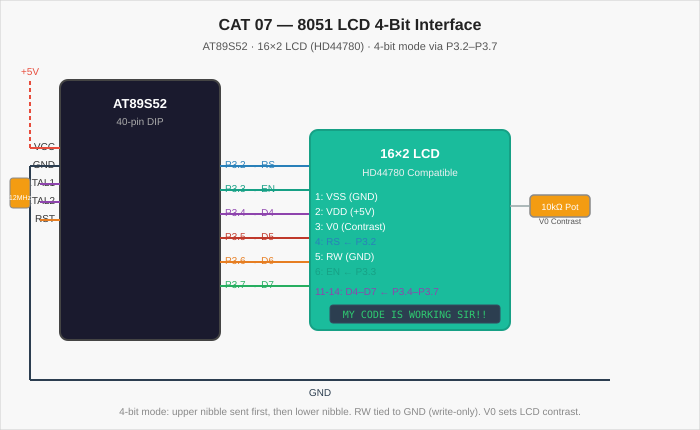

# CAT 07 — 8051 LCD 16×2 Display (4-Bit Interface)

[Evaluation Handout](Assignment/CAT_07_Evaluation.pdf) · [Source Code](Source_Code/lcd_display.c)

## Aim

Write an Embedded C program for the AT89S52 microcontroller to interface a 16×2 alphanumeric LCD (HD44780 compatible) using a 4-bit data interface. Display a custom message on the LCD.

## Components Required

| Component | Specification |
| --- | --- |
| Microcontroller | AT89S52 (8051 family), 40-pin DIP |
| LCD Module | 16×2, HD44780 compatible, 5 V |
| Crystal Oscillator | 12 MHz |
| Capacitors | 2 × 33 pF (crystal), 1 × 10 µF (reset) |
| Resistors | 10 kΩ (RST pull-up) |
| Potentiometer | 10 kΩ (LCD contrast, V0 pin) |
| Power supply | 5 V DC regulated |
| Development tools | Keil µVision (C51 compiler), ISP programmer |

## Circuit Diagram



The LCD is operated in 4-bit mode: only pins D4–D7 of the display are connected to the MCU (D0–D3 are left unconnected). Control pins RS and EN are driven from P3.2 and P3.3 respectively. The RW pin is tied permanently to GND (write-only operation). LCD VDD connects to +5 V; VSS to GND. A 10 kΩ potentiometer between VCC and GND with its wiper on the LCD's V0 pin adjusts contrast.

## Pin Connections

| LCD Pin | Signal | AT89S52 Pin | Notes |
| --- | --- | --- | --- |
| 1 | VSS | GND | — |
| 2 | VDD | VCC (+5 V) | — |
| 3 | V0 (contrast) | Pot wiper | 10 kΩ pot between VCC–GND |
| 4 | RS | P3.2 | 0 = command, 1 = data |
| 5 | RW | GND | Always write |
| 6 | EN | P3.3 | High-to-low pulse latches data |
| 7–10 | D0–D3 | Not connected | 4-bit mode uses upper nibble only |
| 11 | D4 | P3.4 | Bit 0 of nibble |
| 12 | D5 | P3.5 | Bit 1 of nibble |
| 13 | D6 | P3.6 | Bit 2 of nibble |
| 14 | D7 | P3.7 | Bit 3 of nibble |
| 15 | LED+ | VCC (via 10 Ω) | Backlight anode |
| 16 | LED− | GND | Backlight cathode |

## Working Principle

The LCD is initialized with the standard HD44780 power-on sequence in 4-bit mode:
1. Wait > 15 ms after VCC reaches 4.5 V.
2. Send 0x03 (Function Set — 8-bit) three times with the required delays.
3. Send 0x02 (Function Set — switch to 4-bit mode).
4. Issue Function Set (0x28: 4-bit, 2 lines, 5×8 dots), Display On/Cursor Off (0x0C), Entry Mode Set (0x06), and Display Clear (0x01).

Each byte is transferred as two nibbles (high nibble first) using the `lcd_nibble()` function, which loads D4–D7 individually and pulses EN.

## Procedure

1. Connect the LCD to the MCU and GND/VCC as shown in the pin table.
2. Adjust the contrast potentiometer so the display shows faint rectangles before initialization.
3. Create a Keil C51 project, add `lcd_display.c`, and set CPU frequency to 12 MHz.
4. Build and flash the HEX file.
5. Power on; the LCD should display `MY CODE IS WORKING SIR!!` on the first line.

## Source Code

[lcd_display.c](Source_Code/lcd_display.c)

Key functions in the program:

| Function | Purpose |
| --- | --- |
| `delay_ms(ms)` | Software millisecond delay |
| `lcd_enable()` | Generates a high-to-low EN pulse |
| `lcd_nibble(val)` | Sends a 4-bit nibble to D4–D7 and pulses EN |
| `lcd_cmd(val)` | Sends a command byte (RS=0) as two nibbles |
| `lcd_data(val)` | Sends a data byte (RS=1) as two nibbles |
| `lcd_init()` | Full HD44780 power-on initialization |
| `lcd_puts(str)` | Sends a null-terminated string character by character |

The displayed message is `"MY CODE IS WORKING SIR!!"`. Modify `lcd_puts()` argument in `main()` to change the displayed text.

## Expected Output

The 16×2 LCD displays:

```
MY CODE IS WORKING SIR!!
```

on the first row. The cursor is hidden (Display On, Cursor Off: 0x0C). The display remains static; the MCU idles in an infinite loop after initialization.

## Actual Output

Physical hardware execution is pending. The initialization sequence and nibble timing have been verified against the HD44780 datasheet; the program compiles cleanly under Keil C51.

## Result

The program demonstrates successful 4-bit LCD interfacing on the 8051. Separating command and data byte transfers into the `lcd_cmd()` and `lcd_data()` wrappers makes the driver reusable for any HD44780-compatible display. The 4-bit mode halves the GPIO pin requirement compared to the 8-bit interface.
