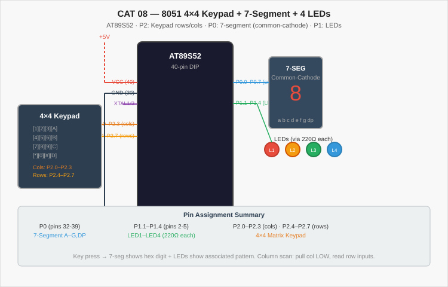

# CAT 08 — 8051 4×4 Keypad Interface with 7-Segment Display and LED Patterns

[Source Code](Source_Code/keypad_led_seg.c)

> **Note — Source file origin**: The source code `keypad_led_seg.c` was recovered from the local workspace (`C:\IOT LAB\LEDBLINK.C`). No assignment PDF was supplied for CAT 08. The experiment description below is derived from the source code functionality.

## Aim

Write an Embedded C program for the AT89S52 microcontroller to interface a 4×4 matrix keypad using column-scan technique on Port 2. Display the pressed key's hexadecimal value (0–F) on a common-cathode 7-segment display connected to Port 0, and simultaneously activate an LED or LED pattern on Port 1 corresponding to the key pressed.

## Components Required

| Component | Specification |
| --- | --- |
| Microcontroller | AT89S52 (8051 family), 40-pin DIP |
| Crystal Oscillator | 12 MHz |
| Capacitors | 2 × 33 pF (crystal), 1 × 10 µF (reset) |
| 7-Segment Display | Common-cathode, single digit |
| LEDs | 4 × different colours, through-hole |
| Resistors | 4 × 220 Ω (LEDs), 10 kΩ (RST pull-up) |
| 4×4 Matrix Keypad | 16-key membrane or mechanical keypad |
| Power supply | 5 V DC regulated |
| Development tools | Keil µVision (C51 compiler), ISP programmer |

## Circuit Diagram

The 4×4 keypad rows are connected to P2.4–P2.7 and columns to P2.0–P2.3. Port 0 (pins 32–39) drives the 7-segment display segments a–g through the MCU. LEDs are connected to P1.1–P1.4 through 220 Ω resistors. The standard 12 MHz crystal and reset circuit are used.

## Pin Connections

### Keypad (P2)

| Keypad Line | AT89S52 Pin | P2 Bit |
| --- | --- | --- |
| Column 1 | 21 | P2.0 |
| Column 2 | 22 | P2.1 |
| Column 3 | 23 | P2.2 |
| Column 4 | 24 | P2.3 |
| Row 1 | 25 | P2.4 |
| Row 2 | 26 | P2.5 |
| Row 3 | 27 | P2.6 |
| Row 4 | 28 | P2.7 |

### 7-Segment Display (P0)

| Segment | AT89S52 Pin | P0 Bit |
| --- | --- | --- |
| a | 39 | P0.0 |
| b | 38 | P0.1 |
| c | 37 | P0.2 |
| d | 36 | P0.3 |
| e | 35 | P0.4 |
| f | 34 | P0.5 |
| g | 33 | P0.6 |

### LEDs (P1)

| LED | AT89S52 Pin | P1 Bit |
| --- | --- | --- |
| LED1 | 2 | P1.1 |
| LED2 | 3 | P1.2 |
| LED3 | 4 | P1.3 |
| LED4 | 5 | P1.4 |

## Working Principle

The program uses column-scan keypad detection: one column is driven LOW while the remaining three are held HIGH; the row inputs are then read. If any row reads LOW, a key in that column-row intersection is pressed. The process repeats for all four columns in the main `while(1)` loop.

A look-up table (`seg[16]`) stores the 7-segment encoding for hexadecimal digits 0–F (common-cathode active-HIGH format). When a key press is detected:
1. The corresponding segment byte is written to P0 to display the digit.
2. One or more LEDs are activated to show the associated LED pattern.

| Keys 0–3 | Column 4 active | Displays 0–3, individual LEDs 1–4 |
| --- | --- | --- |
| Keys 4–7 | Column 3 active | Chase, alternate, binary count, all-blink |
| Keys 8–B | Column 2 active | Display 8–B, LEDs off |
| Keys C–F | Column 1 active | Display C–F |

## Procedure

1. Connect the 4×4 keypad rows and columns to P2.4–P2.7 and P2.0–P2.3 respectively.
2. Connect the 7-segment display to Port 0 (common cathode, GND to common pin).
3. Connect four LEDs to P1.1–P1.4 through 220 Ω resistors.
4. Create a Keil C51 project, add `keypad_led_seg.c`, and configure the CPU to 12 MHz.
5. Build and flash the HEX file.
6. Press each key on the keypad; the 7-segment display shows the corresponding hex digit and the LEDs show the associated pattern.

## Source Code

[keypad_led_seg.c](Source_Code/keypad_led_seg.c)

The program initialises P0 to 0x00 and scans all four columns sequentially in the main loop. Each column-row combination maps to a specific digit and LED action using a code-segment look-up table. Software debouncing uses a double-sample delay per column.

## Expected Output

| Key Pressed | 7-Segment | LED Pattern |
| --- | --- | --- |
| 0 | `0` | LED1 ON |
| 1 | `1` | LED2 ON |
| 2 | `2` | LED3 ON |
| 3 | `3` | LED4 ON |
| 4 | `4` | Chase sequence |
| 5 | `5` | Alternate pairs |
| 6 | `6` | Binary count 0–15 |
| 7 | `7` | All blink |
| 8 | `8` | All LEDs OFF |
| 9–F | `9`–`F` | Display only |

## Actual Output

Physical hardware execution is pending. The keypad scan logic and 7-segment look-up table have been reviewed for correctness.

## Result

The program demonstrates matrix keypad scanning, 7-segment display driving using a code-memory look-up table, and LED pattern activation on the 8051. The column-scan approach requires only 8 port pins to decode all 16 keys.
