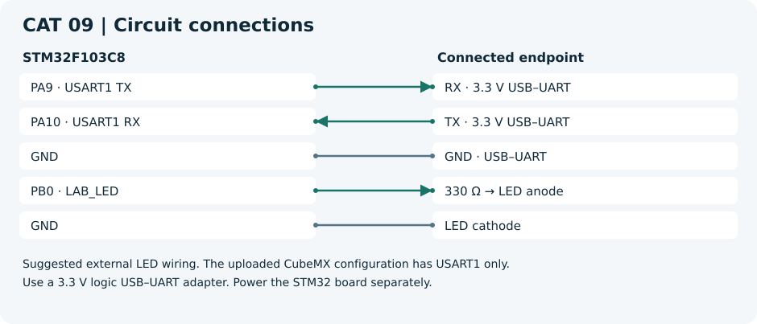

# CAT 09 — STM32 UART Command Controlled LED

[Evaluation handout](Assignment/CAT_09_Evaluation.pdf) · [CubeMX project](Source_Code/cat9.ioc)

## Aim

Send and echo serial characters, then control an LED with terminal commands.

## Components and software

STM32F103C8 board, 3.3 V USB–UART adapter, LED, 330 Ω resistor, jumper wires and PuTTY or Tera Term. Use the STM32 HAL and the toolchain selected when generating the CubeMX project.

## Circuit diagram

Suggested external LED wiring. The uploaded CubeMX configuration has USART1 only.
Use a 3.3 V logic USB–UART adapter. Power the STM32 board separately.

## Pin connections

| Component endpoint | STM32 pin or supply |
| --- | --- |
| RX · 3.3 V USB–UART | PA9 · USART1 TX |
| TX · 3.3 V USB–UART | PA10 · USART1 RX |
| GND · USB–UART | GND |
| 330 Ω → LED anode | PB0 · LAB_LED |
| LED cathode | GND |

## Working principle

A line buffer collects serial input until a line ending, then dispatches the matching GPIO operation. The transmit and echo modes isolate the UART before adding command handling.

## Procedure

Generate the STM32 project from the linked `.ioc` before adding application files. Add each C file to the build, place headers on the include path and call `uart_led_run()` from the generated `main.c` after all peripheral initialization. Add the declaration `void uart_led_run(void);` above `main()` in a CubeMX USER CODE section.

1. Open the supplied CubeMX configuration. Configure USART1 for 115200 baud, 8N1, and no flow control. Set the PC terminal to the same values.
2. For the illustrated external LED, set PB0 as a push-pull GPIO output, label it `LAB_LED` and set its initial level to low. For your board LED, verify its pin and polarity first, then use the same label and set `LED_ON` as needed.
3. Generate the project and add the application C file. Run with `LAB_MODE=0` to transmit a character and with `LAB_MODE=1` to echo.
4. Set `LAB_MODE=2` and send `LED ON`, `LED OFF` and `LED TOGGLE`, each terminated by CR, LF, or CRLF. To compare line endings in the terminal, temporarily replace the transmit test string with the four variants in the handout.

## Source code

[uart_led.c](Source_Code/uart_led.c). The C file is a generated example. The original handout and CubeMX configuration are included for reference.

## Expected output

The terminal displays repeated characters, echoes typed characters, or prints a confirmation as the LED changes state.

## Actual output and result

Physical execution and hardware output are pending. The handout examples describe the expected behavior.
