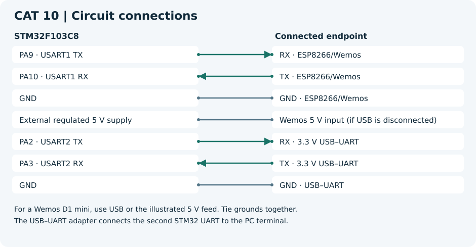
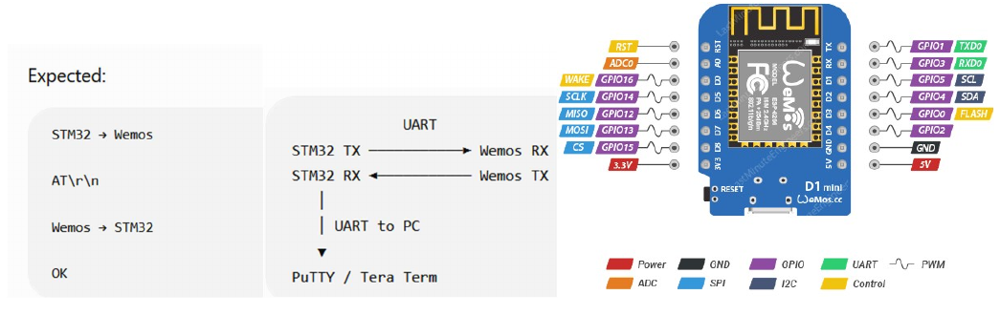

# CAT 10 — STM32–Wemos Wi-Fi Modem Interface Using AT Commands

[Evaluation handout](Assignment/CAT_10_Evaluation.pdf) · [CubeMX project](Source_Code/cat10.ioc)

## Aim

Verify UART AT communication and connect a Wemos/ESP8266 modem to a Wi-Fi access point.

## Components and software

STM32F103C8 board, Wemos D1 mini with AT firmware, 3.3 V USB–UART adapter, modem supply and serial terminal. Use the STM32 HAL and the toolchain selected when generating the CubeMX project.

## Circuit diagram

For a Wemos D1 mini, use USB or the illustrated 5 V feed. Tie grounds together.
A bare ESP8266 module requires its own regulated 3.3 V supply and the boot-enable wiring for that module.
The USB–UART adapter connects the second STM32 UART to the PC terminal.

The handout uses a generic UART example. The first diagram above follows the supplied CubeMX configuration.

## Pin connections

| Component endpoint | STM32 pin or supply |
| --- | --- |
| RX · ESP8266/Wemos | PA9 · USART1 TX |
| TX · ESP8266/Wemos | PA10 · USART1 RX |
| GND · ESP8266/Wemos | GND |
| Wemos 5 V input (if USB is disconnected) | External regulated 5 V supply |
| RX · 3.3 V USB–UART | PA2 · USART2 TX |
| TX · 3.3 V USB–UART | PA3 · USART2 RX |
| GND · USB–UART | GND |

## Working principle

The STM32 sends CRLF-terminated modem commands and forwards replies to the PC on a separate UART. The station join helper disables command echo before sending local Wi-Fi credentials.

## Procedure

Generate the STM32 project from the linked `.ioc` before adding application files. Add each C file to the build, place headers on the include path and call `modem_run()` from the generated `main.c` after all peripheral initialization. Add the declaration `void modem_run(void);` above `main()` in a CubeMX USER CODE section.

1. Use the uploaded mapping of USART1 for the modem and USART2 for the PC. Set USART1 to the modem's current baud rate, typically 115200 baud, 8N1. Set USART2 and the terminal to 230400 baud, 8N1, so modem replies can be forwarded with time to receive the next byte.
2. Add the application and the [AT helper](../Common/esp_at.c) with [its header](../Common/esp_at.h). Run the firmware and inspect the AT reply, firmware version and scan results.
3. Set `WIFI_SSID` and `WIFI_PASSWORD` only in your local build. Verify association and the station IP using `AT+CIFSR`.
4. The handout labels the sub-tasks 9A–9C under the CAT 10 evaluation header. For the command investigation, use `AT+CIPSTART` to open a connection to a lab endpoint and `AT+CIPSEND` to transmit a known byte count after the prompt.

## Source code

[modem.c](Source_Code/modem.c). The C file is a generated example. The original handout and CubeMX configuration are included for reference.

## Expected output

The PC sees the AT response, firmware identification, scan output and station IP after joining Wi-Fi.

## Actual output and result

Physical execution and hardware output are pending. The handout examples describe the expected behavior.

- [Espressif ESP8266 Non-OS AT reference](https://www.espressif.com/sites/default/files/documentation/4a-esp8266_at_instruction_set_en.pdf)
