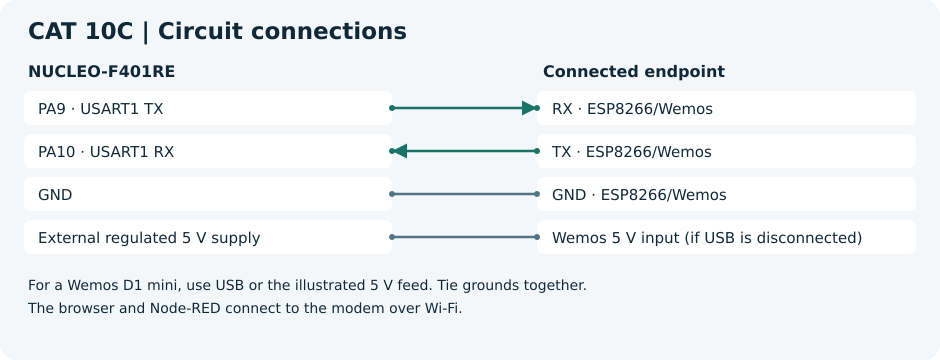

# CAT 10C — HTTP Server - STM32–Wemos Wi-Fi Modem Using AT Commands

[Evaluation handout](Assignment/CAT_10C_Evaluation.docx) · [CubeMX project](Source_Code/CAT-10C.ioc)

## Aim

Serve a static HTTP response through an ESP8266 TCP server and retrieve it in a browser and Node-RED.

## Components and software

NUCLEO-F401RE, ESP8266/Wemos with AT firmware, modem supply, browser and Node-RED. Use the STM32 HAL and the toolchain selected when generating the CubeMX project.

## Circuit diagram

For a Wemos D1 mini, use USB or the illustrated 5 V feed. Tie grounds together.
A bare ESP8266 module requires its own regulated 3.3 V supply and the boot-enable wiring for that module.
The browser and Node-RED connect to the modem over Wi-Fi.

## Pin connections

| Component endpoint | STM32 pin or supply |
| --- | --- |
| RX · ESP8266/Wemos | PA9 · USART1 TX |
| TX · ESP8266/Wemos | PA10 · USART1 RX |
| GND · ESP8266/Wemos | GND |
| Wemos 5 V input (if USB is disconnected) | External regulated 5 V supply |

## Working principle

The firmware enables multiplexed connections and TCP port 80, reads the link ID and payload length from a standard `+IPD,<id>,<len>:` frame, and responds to a GET whose method begins in that frame. It waits for the send prompt and computes the body length separately from the number of bytes given to CIPSEND.

## Procedure

Generate the STM32 project from the linked `.ioc` before adding application files. Add each C file to the build, place headers on the include path and call `http_lab_run()` from the generated `main.c` after all peripheral initialization. Add the declaration `void http_lab_run(void);` above `main()` in a CubeMX USER CODE section.

1. Use USART1 on the Nucleo with the ESP8266 baud rate and 8N1 framing. Connect the modem to the lab Wi-Fi before starting the application, or call `esp_join` with local credentials.
2. Add the application and the [AT helper](../Common/esp_at.c) with [its header](../Common/esp_at.h). Start with an ESP8266 state that has no active TCP server.
3. Open `http://<ESP8266_IP>/` from a device on a network that allows peer connections. In Node-RED, use Inject → HTTP Request (GET, same URL) → Debug.
4. For modem troubleshooting, verify the assigned IP, TCP port 80, and the appearance of `+IPD` when the request reaches the modem.

## Source code

[http_lab.c](Source_Code/http_lab.c). The C file is a generated example. The original handout and CubeMX configuration are included for reference.

## Expected output

The browser renders “STM32 IoT Node” and the Node-RED Debug node receives the HTML response.

## Actual output and result

Physical execution and hardware output are pending. The handout examples describe the expected behavior.

- [ST Nucleo-64 board manual](https://www.st.com/resource/en/user_manual/dm00105823-nucleo-f401re-user-manual-stmicroelectronics.pdf)
- [Espressif ESP8266 Non-OS AT reference](https://www.espressif.com/sites/default/files/documentation/4a-esp8266_at_instruction_set_en.pdf)
