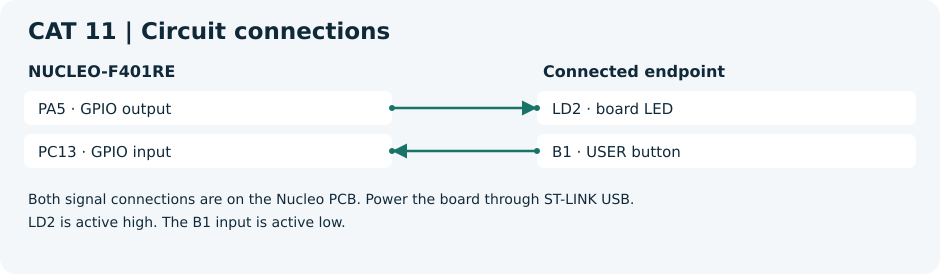

# CAT 11 — STM32F401RE Cortex-M4: GPIO and User Input Programming

[Evaluation handout](Assignment/CAT_11_Evaluation.pdf) · [CubeMX project](Source_Code/cat11.ioc)

## Aim

Blink the on-board LED, toggle it once per valid press, and distinguish short and long presses.

## Components and software

NUCLEO-F401RE with on-board LD2 and B1, ST-LINK USB and CubeMX with Keil MDK. Use the STM32 HAL and the toolchain selected when generating the CubeMX project.

## Circuit diagram

Both signal connections are on the Nucleo PCB. Power the board through ST-LINK USB.
LD2 is active high. The B1 input is active low.

## Pin connections

| Component endpoint | STM32 pin or supply |
| --- | --- |
| LD2 · board LED | PA5 · GPIO output |
| B1 · USER button | PC13 · GPIO input |

## Working principle

A stable transition must persist for 30 ms to be accepted. In task 3 the application measures elapsed time between debounced press and release. The LED keeps its last output state.

## Procedure

Generate the STM32 project from the linked `.ioc` before adding application files. Add each C file to the build, place headers on the include path and call `gpio_lab_run()` from the generated `main.c` after all peripheral initialization. Add the declaration `void gpio_lab_run(void);` above `main()` in a CubeMX USER CODE section.

1. Open the supplied project and confirm PA5 output and PC13 input with pull-up. Review the oscillator and clock tree against your board revision.
2. Run with `LAB_TASK=1` for a 500 ms toggle interval and with `LAB_TASK=2` for one toggle on each debounced press.
3. Run with `LAB_TASK=3`. Release after less than one second for a short press and after at least one second for a long press.

## Source code

[gpio_lab.c](Source_Code/gpio_lab.c). The C file is a generated example. The original handout and CubeMX configuration are included for reference.

## Expected output

Task 1 blinks LD2. Task 2 toggles LD2 on press. In task 3 a short press toggles LD2 and a long press turns it off.

## Actual output and result

Physical execution and hardware output are pending. The handout examples describe the expected behavior.

- [ST Nucleo-64 board manual](https://www.st.com/resource/en/user_manual/dm00105823-nucleo-f401re-user-manual-stmicroelectronics.pdf)
