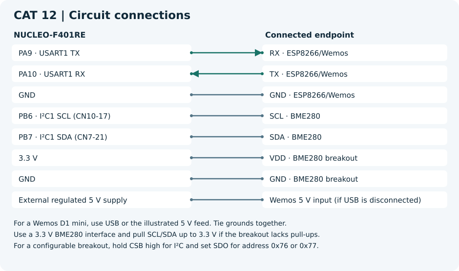

# CAT 12 — BME280 Sensor Interfacing Using I²C and Bosch Sensor API

[Evaluation handout](Assignment/CAT_12_Evaluation.pdf) · [CubeMX project](Source_Code/CAT12.ioc)

## Aim

Read compensated temperature, humidity and pressure, serve them as HTTP JSON, and calculate statistics in Node-RED.

## Components and software

NUCLEO-F401RE, BME280 I²C breakout, ESP8266/Wemos, Bosch SensorAPI, CubeMX, debugger, browser and Node-RED. Use the STM32 HAL and the toolchain selected when generating the CubeMX project.

## Circuit diagram

For a Wemos D1 mini, use USB or the illustrated 5 V feed. Tie grounds together.
A bare ESP8266 module requires its own regulated 3.3 V supply and the boot-enable wiring for that module.
Use a 3.3 V BME280 interface and pull SCL/SDA up to 3.3 V if the breakout lacks pull-ups.
For a configurable breakout, hold CSB high for I²C and set SDO for address 0x76 or 0x77.

## Pin connections

| Component endpoint | STM32 pin or supply |
| --- | --- |
| RX · ESP8266/Wemos | PA9 · USART1 TX |
| TX · ESP8266/Wemos | PA10 · USART1 RX |
| GND · ESP8266/Wemos | GND |
| SCL · BME280 | PB6 · I²C1 SCL (CN10-17) |
| SDA · BME280 | PB7 · I²C1 SDA (CN7-21) |
| VDD · BME280 breakout | 3.3 V |
| GND · BME280 breakout | GND |
| Wemos 5 V input (if USB is disconnected) | External regulated 5 V supply |

## Working principle

HAL I²C callbacks read and write sensor registers. Bosch compensation produces °C, Pa and %RH. The application converts Pa to hPa and constructs an HTTP JSON body for each GET.

## Procedure

Generate the STM32 project from the linked `.ioc` before adding application files. Add each C file to the build, place headers on the include path and call `bme_http_run()` from the generated `main.c` after all peripheral initialization. Add the declaration `void bme_http_run(void);` above `main()` in a CubeMX USER CODE section.

1. Add [the BME280 adapter](../Common/bme_lab.c), [its header](../Common/bme_lab.h), and the [Bosch driver](../Common/Bosch_BME280/). Add the [AT helper](../Common/esp_at.c) and [its header](../Common/esp_at.h). Build with floating-point support for `snprintf` (for GCC newlib-nano, use `-u _printf_float`).
2. Select `LAB_SENSOR_ONLY=1` to take periodic readings before Wi-Fi setup. Check `lab_chip_id` for 0x60 and watch the temperature, pressure and humidity variables. The driver defaults to address 0x76. Use `LAB_BME_ADDRESS=0x77` for the alternate strap setting. To log to a PC, add USART2 on PA2/PA3 for the Nucleo ST-LINK virtual COM port and define `LAB_DEBUG_UART`.
3. Restore `LAB_SENSOR_ONLY=0`, join Wi-Fi on the ESP8266 and run the HTTP endpoint. Use the same basic modem settings as CAT 10C.
4. In Node-RED, use a periodic Inject → HTTP Request (GET, parsed JSON) → Function → Debug. Paste [the statistics code](Source_Code/node_red_statistics.js) into Function to show running minimum, maximum and average.

## Source code

[bme_http.c](Source_Code/bme_http.c). The C file is a generated example. The original handout and CubeMX configuration are included for reference.

## Expected output

The HTTP client receives a JSON object with numeric temperature, humidity and pressure fields. The Node-RED output summarizes accepted readings.

## Actual output and result

Physical execution and hardware output are pending. The handout examples describe the expected behavior.

- [ST Nucleo-64 board manual](https://www.st.com/resource/en/user_manual/dm00105823-nucleo-f401re-user-manual-stmicroelectronics.pdf)
- [Espressif ESP8266 Non-OS AT reference](https://www.espressif.com/sites/default/files/documentation/4a-esp8266_at_instruction_set_en.pdf)
