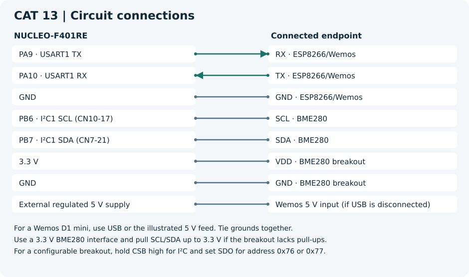

# CAT 13 — BME280 Sensor Interfacing Using I²C and (MQTT) using Custom Built ESP8266 API

[Evaluation handout](Assignment/CAT_13_Evaluation.pdf) · [CubeMX project](Source_Code/cat-13(1).ioc)

## Aim

Publish compensated BME280 measurements to an MQTT broker and display them in Node-RED.

## Components and software

NUCLEO-F401RE, BME280 breakout, ESP8266/Wemos, Bosch SensorAPI, course ESPLib, MQTT broker and Node-RED. Use the STM32 HAL and the toolchain selected when generating the CubeMX project.

## Circuit diagram

For a Wemos D1 mini, use USB or the illustrated 5 V feed. Tie grounds together.
A bare ESP8266 module requires its own regulated 3.3 V supply and the boot-enable wiring for that module.
Use a 3.3 V BME280 interface and pull SCL/SDA up to 3.3 V if the breakout lacks pull-ups.
For a configurable breakout, hold CSB high for I²C and set SDO for address 0x76 or 0x77.

## Pin connections

| Component endpoint | STM32 pin or supply |
| --- | --- |
| RX · ESP8266/Wemos | PA9 · USART1 TX |
| TX · ESP8266/Wemos | PA10 · USART1 RX |
| GND · ESP8266/Wemos | GND |
| SCL · BME280 | PB6 · I²C1 SCL (CN10-17) |
| SDA · BME280 | PB7 · I²C1 SDA (CN7-21) |
| VDD · BME280 breakout | 3.3 V |
| GND · BME280 breakout | GND |
| Wemos 5 V input (if USB is disconnected) | External regulated 5 V supply |

## Working principle

The sensor adapter produces a JSON sample and the course MQTT API publishes it with QoS 0. The Node-RED function routes numeric measurements to three separate outputs.

## Procedure

Generate the STM32 project from the linked `.ioc` before adding application files. Add each C file to the build, place headers on the include path and call `bme_mqtt_run()` from the generated `main.c` after all peripheral initialization. Add the declaration `void bme_mqtt_run(void);` above `main()` in a CubeMX USER CODE section.

1. Use I²C1 and USART1 as configured in the uploaded project. The handout example uses USART2. Adapt any UART references or callbacks inside the course library to USART1 before using this configuration.
2. Add [the BME280 adapter](../Common/bme_lab.c), [its header](../Common/bme_lab.h) and [the Bosch driver](../Common/Bosch_BME280/). Enable float formatting in the project.
3. Obtain `ESPLib.c` and `ESPLib.h` from the course repository, add them to the generated project and verify the API signatures and return conventions against the supplied integration. If the course driver requires `MQTTTimer()` or UART receive interrupts for publishing, register them according to that version and enable USART1 interrupts in CubeMX.
4. Set local Wi-Fi, broker, topic and client ID settings. Subscribe to that exact topic in Node-RED using MQTT In → JSON → Function. Paste [the three-output function](Source_Code/node_red_values.js) and wire outputs for temperature, humidity and pressure.

## Source code

[bme_mqtt.c](Source_Code/bme_mqtt.c). The C file is a generated example. The original handout and CubeMX configuration are included for reference.

## Expected output

Node-RED receives periodic MQTT messages with the three readings. The integration is conditional on obtaining and configuring the course library.

## Actual output and result

Physical execution and hardware output are pending. The handout examples describe the expected behavior.

- [ST Nucleo-64 board manual](https://www.st.com/resource/en/user_manual/dm00105823-nucleo-f401re-user-manual-stmicroelectronics.pdf)
- [Espressif ESP8266 Non-OS AT reference](https://www.espressif.com/sites/default/files/documentation/4a-esp8266_at_instruction_set_en.pdf)
