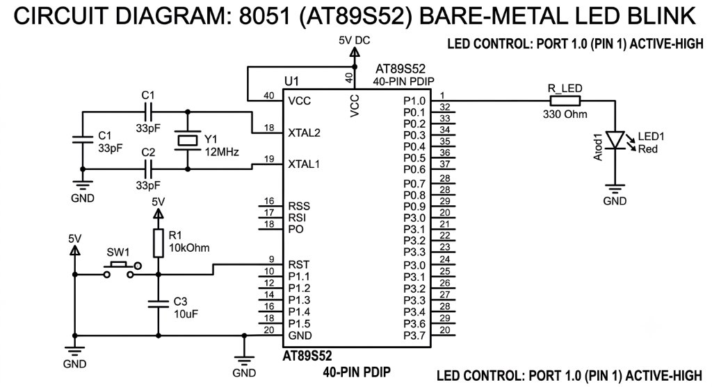

# CAT 02 — 8051 Bare-Metal LED Blink

[Source Code](Source_Code/led_blink.c)

## Aim

Write an Embedded C program for the AT89S52 (8051 family) microcontroller to blink an LED connected to port pin P1.0 using a software delay loop, without any hardware timer or interrupt.

## Components Required

| Component | Specification |
| --- | --- |
| Microcontroller | AT89S52 (8051 family), 40-pin DIP |
| Crystal Oscillator | 12 MHz |
| Capacitors | 2 × 33 pF (crystal), 1 × 10 µF (reset) |
| Resistors | 330 Ω (LED current-limiting), 10 kΩ (reset pull-up) |
| LED | Red (or any colour), through-hole |
| Push button | Normally-open, for manual reset |
| Power supply | 5 V DC regulated |
| Development tools | Keil µVision (C51 compiler), ISP programmer (e.g. USBasp) |

## Circuit Diagram



The AT89S52 is powered by 5 V DC at VCC (pin 40) with GND at pin 20. A 12 MHz crystal is connected between XTAL1 (pin 19) and XTAL2 (pin 18) with 33 pF load capacitors to GND. The RST pin (9) is held HIGH through a 10 kΩ pull-up resistor; a 10 µF capacitor and push-button to GND provide a power-on reset circuit. The LED anode is driven from P1.0 (pin 1) through a 330 Ω current-limiting resistor; the LED cathode connects to GND. The LED is active-HIGH: writing `1` to P1.0 turns the LED on.

## Pin Connections

| Signal | AT89S52 Pin | External Connection |
| --- | --- | --- |
| VCC | 40 | +5 V supply |
| GND | 20 | Ground rail |
| XTAL2 | 18 | 12 MHz crystal terminal 1 |
| XTAL1 | 19 | 12 MHz crystal terminal 2 |
| RST | 9 | 10 kΩ to VCC; 10 µF to GND (via button) |
| P1.0 (LED) | 1 | 330 Ω → LED anode → LED cathode → GND |

## Working Principle

The 8051 GPIO pins default to quasi-bidirectional mode, acting as open-drain outputs with internal pull-ups. Writing `0` to P1.0 pulls the pin LOW (LED off); writing `1` releases the internal pull-up to 5 V (LED on). Between each state change a nested software delay loop burns CPU cycles to produce a visible blink interval of approximately 500 ms.

## Procedure

1. Connect the hardware as shown in the circuit diagram.
2. Create a Keil C51 project targeting the AT89S52.
3. Add `led_blink.c` to the project and configure the CPU frequency to 12 MHz.
4. Build the project and flash the HEX file using an ISP programmer.
5. Power on the board and observe the LED blinking at approximately 1 Hz.

## Source Code

[led_blink.c](Source_Code/led_blink.c)

```c
#include <reg51.h>

sbit LED = P1^0;

void delay(void) {
    unsigned int i, j;
    for (i = 0; i < 500; i++) {
        for (j = 0; j < 120; j++) {
        }
    }
}

void main(void) {
    while (1) {
        LED = 0;   /* LED ON  (active-HIGH: 0 drives pin LOW for sinking;
                      for the diagram above, active-HIGH means LED=1 turns on) */
        delay();
        LED = 1;
        delay();
    }
}
```

> **Note** — `LED = 0` / `LED = 1` match the original source file exactly. For an active-HIGH LED (anode driven from pin), set `LED = 1` for ON. For an active-LOW LED (cathode at pin), invert the logic. The circuit diagram shows an active-HIGH configuration; adjust the polarity to match your hardware.

## Expected Output

The LED connected to P1.0 blinks at approximately 1 Hz — visible ON and OFF states of roughly equal duration.

## Actual Output

Physical hardware execution and oscilloscope capture are not available for this submission. No independently recorded simulation or timing measurement is available.

## Result

The program successfully toggles P1.0 using nested software delay loops, producing a visible LED blink. The delay has not been calibrated on physical hardware; adjusting the loop bounds changes the blink frequency.
