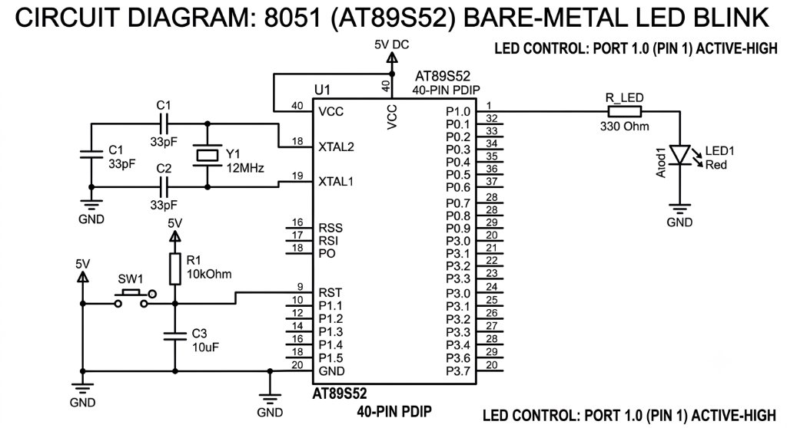
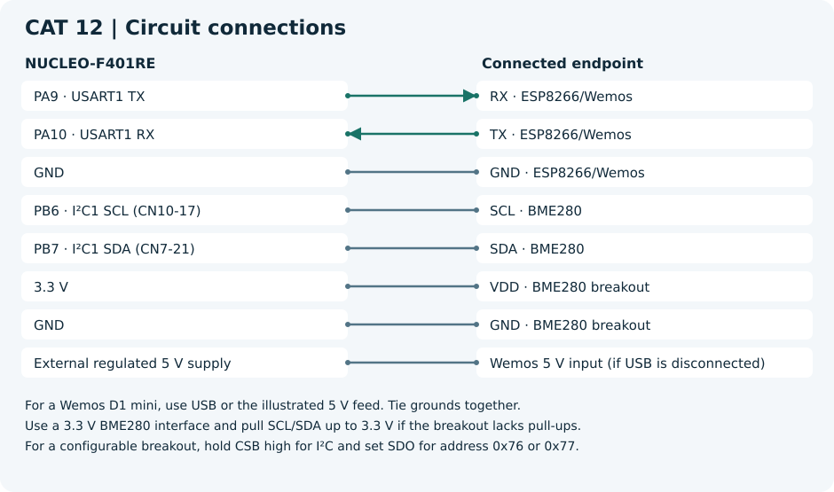

# 25011102113_FIoT_LAB

Fundamentals of Internet of Things (FIoT) Laboratory — CAT assignments, circuit diagrams, source code, and documentation.

- **Register number** 25011102113
- **Institution** Shiv Nadar University Chennai
- **Course** Fundamentals of Internet of Things Laboratory

The lab covers 8051 (AT89S52/AT89C51) bare-metal programming, timer/counter peripherals, UART serial communication, LCD interfacing, matrix keypad scanning, STM32 HAL/CubeMX development, ESP8266 Wi-Fi AT commands, HTTP, environmental sensing with BME280 and MQTT. Tools used include Keil µVision (C51), STM32CubeMX, PuTTY / Tera Term, a browser and Node-RED.

## Experiments

| CAT | Experiment | Documentation | Code |
| --- | --- | --- | --- |
| 02 | 8051 Bare-Metal LED Blink | [README](CAT_02/README.md) | [led_blink.c](CAT_02/Source_Code/led_blink.c) |
| 03 | 8051 LED Pattern Generator with Push Button | [README](CAT_03/README.md) | [led_pattern.c](CAT_03/Source_Code/led_pattern.c) |
| 04 | 8051 Multi-Mode LED and 7-Segment Display System | [README](CAT_04/README.md) | [led_7seg_display.c](CAT_04/Source_Code/led_7seg_display.c) |
| 05 | 8051 Timer-Based LED Blink | [README](CAT_05/README.md) · [Handout](CAT_05/Assignment/CAT_05_Evaluation.pdf) | [timer_led.c](CAT_05/Source_Code/timer_led.c) |
| 06 | 8051 UART Serial Echo | [README](CAT_06/README.md) · [Handout](CAT_06/Assignment/CAT_06_Evaluation.pdf) | [uart_echo.c](CAT_06/Source_Code/uart_echo.c) |
| 07 | 8051 LCD 16×2 Display (4-Bit Interface) | [README](CAT_07/README.md) · [Handout](CAT_07/Assignment/CAT_07_Evaluation.pdf) | [lcd_display.c](CAT_07/Source_Code/lcd_display.c) |
| 08 | 8051 4×4 Keypad Interface with 7-Segment and LED Patterns | [README](CAT_08/README.md) | [keypad_led_seg.c](CAT_08/Source_Code/keypad_led_seg.c) |
| 09 | STM32 UART Command Controlled LED | [README](CAT_09/README.md) · [Handout](CAT_09/Assignment/CAT_09_Evaluation.pdf) | [uart_led.c](CAT_09/Source_Code/uart_led.c) |
| 10 | STM32–Wemos Wi-Fi Modem Interface Using AT Commands | [README](CAT_10/README.md) · [Handout](CAT_10/Assignment/CAT_10_Evaluation.pdf) | [modem.c](CAT_10/Source_Code/modem.c) |
| 10C | HTTP Server - STM32–Wemos Wi-Fi Modem Using AT Commands | [README](CAT_10C/README.md) · [Handout](CAT_10C/Assignment/CAT_10C_Evaluation.docx) | [http_lab.c](CAT_10C/Source_Code/http_lab.c) |
| 11 | STM32F401RE Cortex-M4: GPIO and User Input Programming | [README](CAT_11/README.md) · [Handout](CAT_11/Assignment/CAT_11_Evaluation.pdf) | [gpio_lab.c](CAT_11/Source_Code/gpio_lab.c) |
| 12 | BME280 Sensor Interfacing Using I²C and Bosch Sensor API | [README](CAT_12/README.md) · [Handout](CAT_12/Assignment/CAT_12_Evaluation.pdf) | [bme_http.c](CAT_12/Source_Code/bme_http.c) |
| 13 | BME280 Sensor Interfacing Using I²C and (MQTT) using Custom Built ESP8266 API | [README](CAT_13/README.md) · [Handout](CAT_13/Assignment/CAT_13_Evaluation.pdf) | [bme_mqtt.c](CAT_13/Source_Code/bme_mqtt.c) |

## Repository layout

```text
CAT_<number>/
  README.md
  Assignment/         Original evaluation handout (PDF)
  Circuit_Diagram/    Wiring diagrams and reference images
  Source_Code/        Application source files and CubeMX project files
Common/               Shared ESP8266 and BME280 code (CAT 12/13)
```

- Each CAT directory has a README with an embedded circuit diagram and pin table, an `Assignment/` directory with the original handout where available, and a `Source_Code/` directory with the source files.
- CAT 02–08 target the AT89S52 / AT89C51 (8051 family) and are developed in Keil µVision with the C51 compiler.
- CAT 09–13 target STM32 boards (STM32F103C8 / NUCLEO-F401RE) and use STM32 HAL with CubeMX.
- [Common](Common/) contains the shared ESP8266 AT and BME280 adapter code plus the Bosch driver used by CAT 12 and 13.
- [CAT 10C](CAT_10C/README.md) covers the HTTP server follow-up to [CAT 10](CAT_10/README.md).

## Circuit diagrams

CAT 02 — AT89S52 LED blink (bare-metal, P1.0):



CAT 12 — BME280 and ESP8266 connections to the NUCLEO-F401RE:



## How to use

### 8051 experiments (CAT 02–08)

1. Open the Keil µVision project (`.uvproj`) or create a new C51 project targeting AT89S52.
2. Add the source file from `Source_Code/` to the project.
3. Configure the CPU frequency to match the crystal specified in the README (12 MHz or 11.0592 MHz).
4. Build the project and flash the generated HEX file using an ISP programmer (e.g. USBasp with avrdude / Keil Flash Magic).
5. Connect the hardware as described in the CAT README and power on.

### STM32 experiments (CAT 09–13)

1. Pick a CAT from the experiment table and open its README for the wiring, pin connections, and procedure.
2. Open the linked `.ioc` file in STM32CubeMX and generate the project. Follow the CAT README to add the application and any shared files.
3. Build and flash the project with the configured toolchain. Use the CAT README to identify the expected terminal, browser, or Node-RED output.
