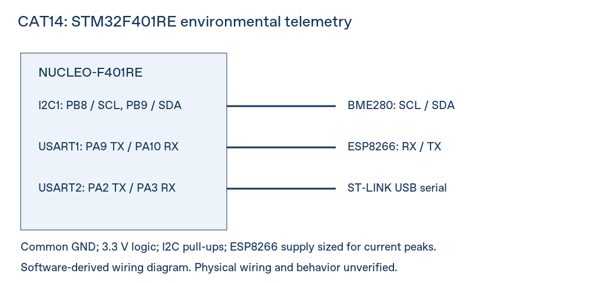

# CAT14 / TASK14: Environmental sensing and MQTT telemetry

## Aim and provenance

Read real BME280 measurements on STM32F401RE and publish JSON over an ESP8266 TCP/MQTT connection. Adapted from the user-designated [donor repository](https://github.com/saketh3159/25011102092_FIoT_LAB), commit `1eb9b35fc7c64b5af9bed676f3a492881984d5ef`, `STM32/CAT15/TASK15`. The donor CAT14 skeleton did not implement its documented telemetry, so this complete project is adapted for CAT14. No assignment handout was available; full handout compliance is unverified.

## Hardware and software

NUCLEO-F401RE, BME280 breakout, ESP8266 with compatible AT firmware, suitable 3.3 V supply, common ground, STM32 HAL, Bosch BME280 SensorAPI, GNU Arm GCC or Keil MDK, and Node-RED for the CAT15 dashboard.

## Circuit diagram and pin connections



| MCU signal | Connection |
|---|---|
| PB8 / SCL, PB9 / SDA | BME280 I2C1, pull-ups to 3.3 V |
| PA9 / USART1 TX | ESP8266 RX, 115200 8-N-1 |
| PA10 / USART1 RX | ESP8266 TX |
| PA2 / USART2 TX | ST-LINK serial terminal, 115200 8-N-1 |
| PA3 / USART2 RX | ST-LINK serial terminal |
| PA5 | Onboard LED |

Use 3.3 V logic and a supply supporting ESP8266 current peaks. BME280 CSB is HIGH for I2C; SDO selects 0x76 or 0x77. The diagram is derived from source/MSP and CubeMX pin configuration; physical wiring is unverified.

## Working principle and implementation

The application probes addresses 0x76/0x77, checks Bosch initialization and compensation settings, and reads temperature, pressure and humidity. Failed sensor reads are discarded. It sends an anonymous MQTT 3.1.1 CONNECT, checks a successful CONNACK, and publishes valid samples every five seconds at QoS 0. JSON keys are `temperature` (C), `pressure` (hPa), and `humidity` (%RH). Topic: `fiot/25011102113/cat14/environment` on `broker.emqx.io:1883`.

The corrected polling ESP8266 driver uses bounded timeouts, checked buffers, binary packet construction and variable MQTT Remaining Length encoding. Only clean-session anonymous CONNECT and QoS 0 PUBLISH are implemented. ESP-AT must use single-connection active receive mode with default `+IPD,<length>:` framing. Modem/broker failures halt with a serial message; reset after correcting the connection. Automatic reconnection, TLS and publish acknowledgments are not implemented. SEND OK confirms modem transport acceptance, not subscriber delivery.

## Compile and execute

From the repository root:

```sh
python3 tools/build.py STM32/CAT14/TASK14
```

See [build setup](../../../docs/BUILDING.md). Alternatively open `MDK-ARM/IOT_project.uvprojx` in Keil with STM32F4 support. Configure local Wi-Fi in `Core/Inc/wifi_config.h` using the included example, rebuild, flash and open the serial terminal. Keep real credentials out of Git. Subscribe to the topic above. Keil and flashing are unverified.

## Expected output

Successful sensor and MQTT initialization followed by serial measurements and JSON at five-second intervals. Example schema only (not a measured result): `{"temperature":25.0,"pressure":1013.25,"humidity":50.0}`.

## Actual verified results

Consult [fresh build evidence](../../../docs/build_results.json) and [validation notes](../../../docs/VALIDATION.md). Host tests cover MQTT serialization, rejection of oversized input, broker rejection and transport timeout. No physical measurements, hardware execution, simulator runs or live broker delivery are claimed.

## References

[Attribution and licenses](../../../docs/ATTRIBUTION.md); Bosch notices are retained in `Core/BOSCH_LICENSE`. Existing source/vendor notices remain intact.
