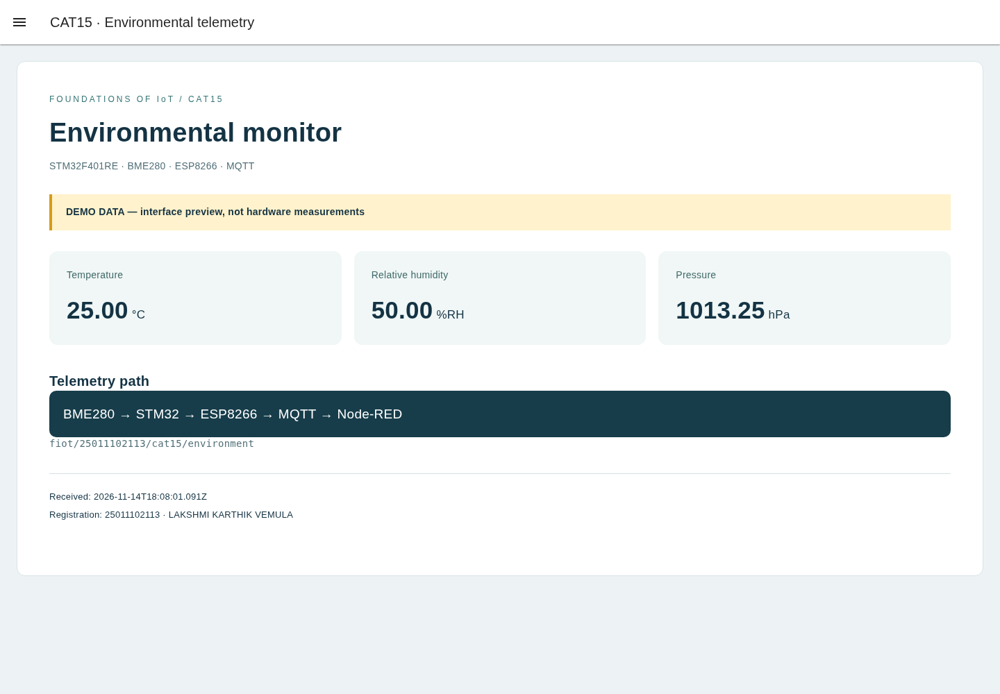

# CAT15 Node-RED dashboard

This is a real Node-RED + FlowFuse Dashboard flow. The included screenshot is captured from this running flow with **DEMO DATA**, not from hardware and not from the donor's laboratory.

## Run locally

Install Node.js 22 or newer (Node-RED 5 requirement; verified with Node.js 24). In this folder run `npm install`, then `npm start`. Open `http://127.0.0.1:1880/dashboard/environment`; the editor is at `http://127.0.0.1:1880/`. The server binds to localhost. Dependencies are pinned in package.json.

The enabled one-shot Inject node sends a labeled synthetic example (25 C, 50 %RH, 1013.25 hPa). No MQTT messages are published by this flow. The live MQTT input is disabled for preview.

## Connect actual hardware

Disable the DEMO Inject node, enable the MQTT input, deploy, and flash the configured CAT15 firmware. Both use topic `fiot/25011102113/cat15/environment` on `broker.emqx.io:1883`. Observe independent serial output and verify each measurement. The public broker topic is unauthenticated, so received messages alone do not establish source authenticity. Change to a broker/topic you control for dependable testing.

The validation node rejects malformed JSON, nonnumeric/nonfinite fields, humidity outside 0–100 and nonpositive pressure. Units: temperature in C, pressure in hPa, humidity in %RH. Schema keys match main.c.

## Actual interface capture

Live hardware values, broker delivery and physical test results remain unverified.
