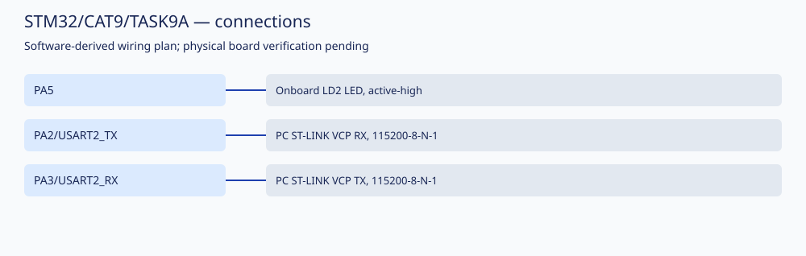

# STM32/CAT9/TASK9A: NUCLEO UART character echo

Student: **LAKSHMI KARTHIK VEMULA** · Registration: **25011102113**
Course: Fundamentals of IoT Laboratory · Shiv Nadar University Chennai, Computer Science and Engineering

## Aim

Implement and examine nucleo uart character echo on STM32F401RET6 NUCLEO-F401RE.

## Components required and hardware platform

STM32F401RET6 NUCLEO-F401RE board, USB/ST-LINK debugger, serial terminal, and the peripherals listed below.

Use board power and common GND. STM32 GPIO signals use 3.3 V logic. Verify supply/current requirements and voltage compatibility before connecting peripherals.

## Circuit diagram



This schematic records the configured software pins. Actual board wiring, component ratings and timing have **NOT VERIFIED** status.

## Pin connections

| MCU signal | Connection |
|---|---|
| PA5 | Onboard LD2 LED, active-high |
| PA2/USART2_TX | PC ST-LINK VCP RX, 115200-8-N-1 |
| PA3/USART2_RX | PC ST-LINK VCP TX, 115200-8-N-1 |

For an ESP8266, use a supply capable of its peak current and compatible AT-command firmware. Hardware UART bridges, modem responses and sensor readings require board testing.

## Working principle and implementation

Received USART2 characters are echoed to the PC terminal.

Read the complete [application source](Core/Src/main.c) for the implemented state transitions, parser, delays and peripheral initialization. Documentation follows the actual code, rather than conflicting titles in the source reference.

## Compilation instructions

From the repository root, run:

```sh
python3 tools/build.py STM32/CAT9/TASK9A
```

See [toolchain setup and build limits](../../../docs/BUILDING.md). Fresh firmware is written to `Objects/firmware.hex`. The GNU build compiles the project sources, assembles the device vector table through GNU startup, links firmware, and emits Intel HEX. Keil MDK and CubeMX regeneration have not been run.

## Expected output

Received USART2 characters are echoed to the PC terminal.

## Actual verified results

See [recorded build and file checks](../../../docs/VALIDATION.md) for the result and artifact hash. A successful compile/link does not verify timing, peripherals or assignment behavior. Hardware execution, oscilloscope measurements and simulator runs are **NOT VERIFIED**.

## References and attribution

This task contains reference-derived source/project material, with documented corrections. It is not represented as solely student-authored code or as independently completed physical laboratory work. See [provenance and third-party notices](../../../docs/ATTRIBUTION.md). The circuit SVG and this task documentation were generated for this repository.
